# AIを活用したパーソナライゼーション

**目的：** Adobe Journey OptimizerのAIを使用して、件名の生成、メールテキストの調整、トーンの調整、ブランドに即したFirefly画像の作成を、電子メールデザイナー内で直接行う方法を説明します。

## 学習目標

このモジュールの終わりまでに、次のことが可能になります。

1. AIを活用して件名とプリヘッダーを生成。
1. ヒーローテキスト、説明、トーン、メッセージを調整する。
1. AIを利用した言い換え、要約、トーン調整を適用できます。
1. Adobe Fireflyの参照スタイルとブランド設定を利用して画像を生成。
1. メールデザイン内で、プレースホルダーを生成画像に置き換えます。

## はじめに

AJOのAI アシスタントは、よりスマートでブランドに即したコンテンツの構築を支援します。
次のことが可能です。

- 件名を生成
- 既存のテキストの改善
- トーンと明瞭度の調整
- Fireflyを使用してブランド画像を作成する
- すべてがConnection 5G ガイドラインに準拠していることを確認します

この演習では、AIを使用して作成したメールを改善します。

>[!NOTE]
>
>AIは&#x200B;**非決定論的**&#x200B;です。つまり、使用されるたびに少し異なるコンテンツが生成される可能性があります。 練習中に表示される内容は、このガイドのスクリーンショットや例と完全に一致しない場合があります。 それは構いません。同じ結果を期待するのではなく、プロセスと概念を学ぶことに焦点を当てます。

## AIを活用してメールの件名を作成

1. 戻るボタンをクリックしてCampaignに戻るか、前のモジュールで作成したメールを編集します。 前の手順から、右側の「**設定**」タブをクリックできます。
2. メールコンテナをクリックし、「メールを編集」ボタンをクリックします。
3. 「コンテンツ」タブをクリックし、「メール本文」をクリックします
4. 「**件名**」フィールドを選択します。
5. **AI アイコン**&#x200B;をクリックします。 （以下を参照）

   件名フィールドツールバーの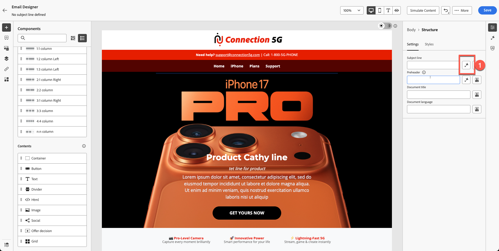

6. 初期設定では、ブランドガイドラインが選択されています。
7. プロンプトを入力します。

   >IPhone 17を発表しました。件名の魅力的さを強調し

8. **Generate**&#x200B;を押します。
9. 生成された4つのバリエーションを確認します。
10. 最適な整列スコアのバリエーションを選択し、**選択**&#x200B;をクリックします。

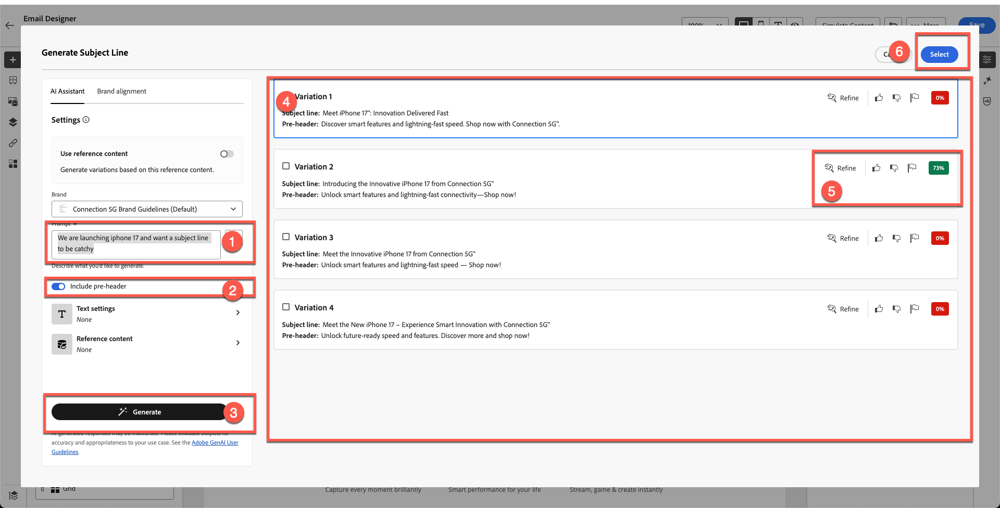

>[!NOTE]
>
>結果はラボガイドとは完全に異なる場合があるため、心配する必要はありません。 正しいタイトルと思われるものを選択し、ラボに進みます。

## ヒーローのタイトルと説明を改善

1. 「メール本文を編集」ボタンをクリックしてメールを開きます。

   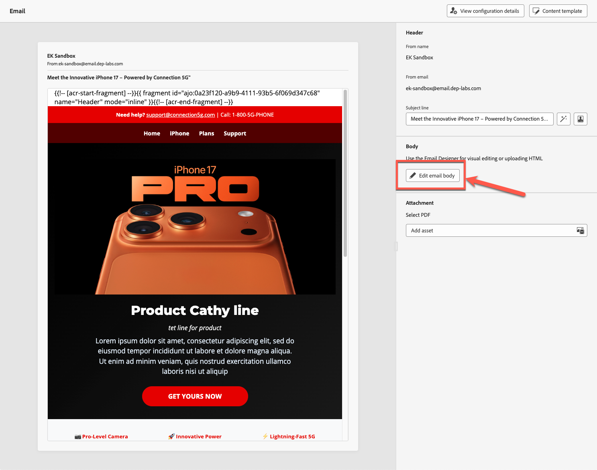

2. 「**Product Catchy line**」見出しをクリックします。
3. 「**テキストを生成して選択**」をクリックして、AI支援を開始します

   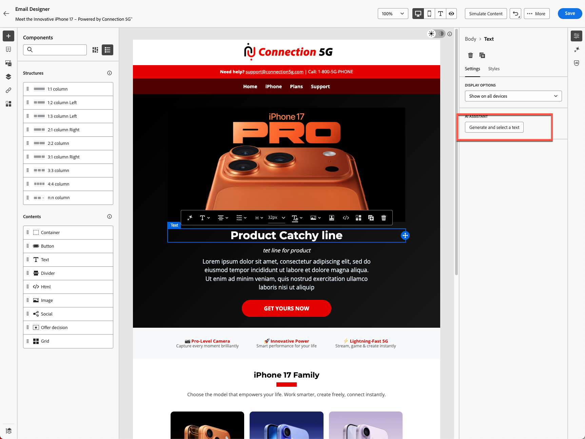

4. ドロップダウンから「**接続5G ブランドガイドライン**」を選択します。

   AI ドロップダウンで「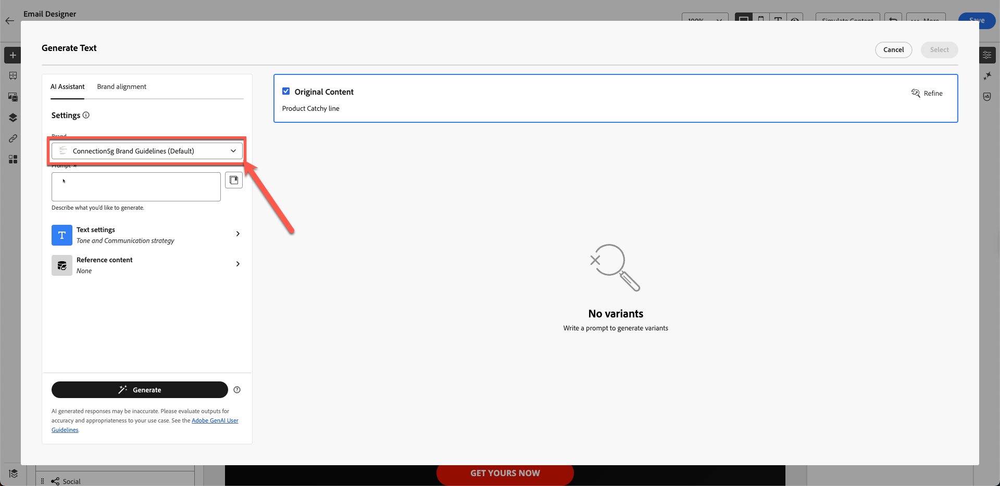

5. プロンプト：

   >*iPhone 17のローンチに向けて、注目を集める大胆な見出しを作成します。 10語以内にする*

6. 「テキスト設定」をクリックして、トーンとコミュニケーション戦略を変更します。 コミュニケーション戦略を&#x200B;**FOMO （見逃すことへの恐れ）**&#x200B;に、言語を&#x200B;**英語**&#x200B;に、トーンを&#x200B;**刺激的**&#x200B;に変更します。

   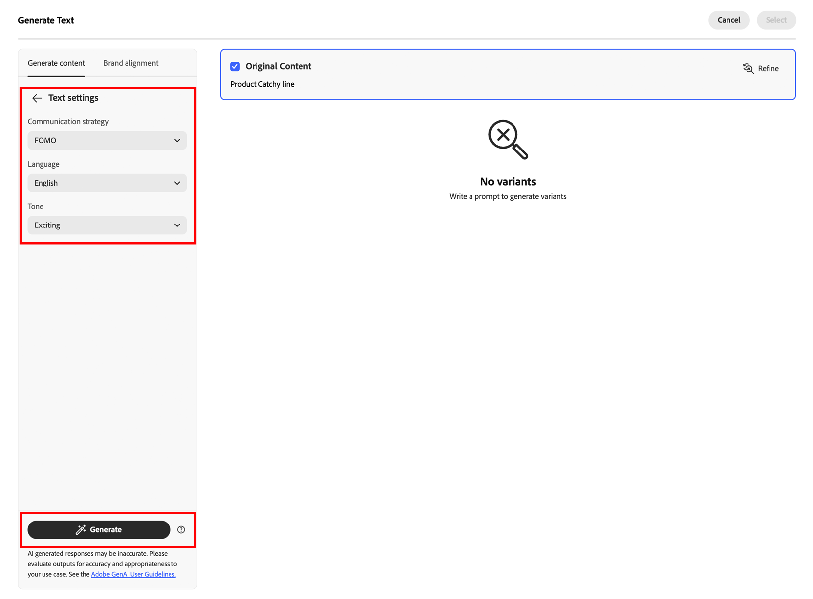

7. 「**生成**」ボタンをクリックします
8. 最適なバージョンをレビューして&#x200B;**選択**&#x200B;してください

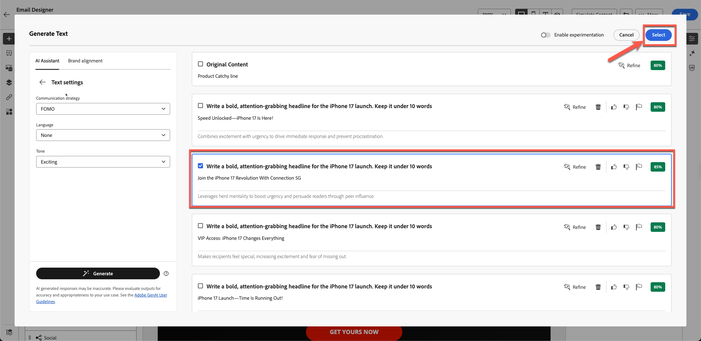

## 説明プロンプト

AIを活用して課題を特定する方法を解説します。

1. 下のテキストはテンプレート化されたテキストで、意味がありません。

   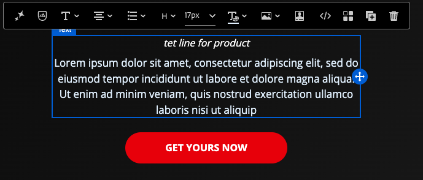

2. 次に示すように、「評価」ボタンをクリックします。

   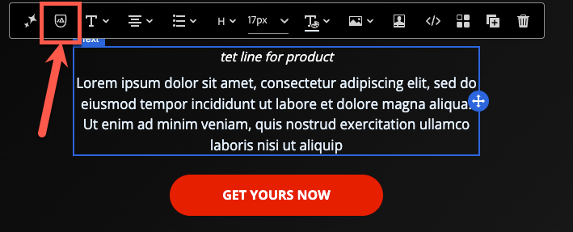

3. 次の手順1と2に示すように、元のコンテンツはブランドに合わせて自動的に選択されます。 「**評価**」ボタンをクリックして続行します。

   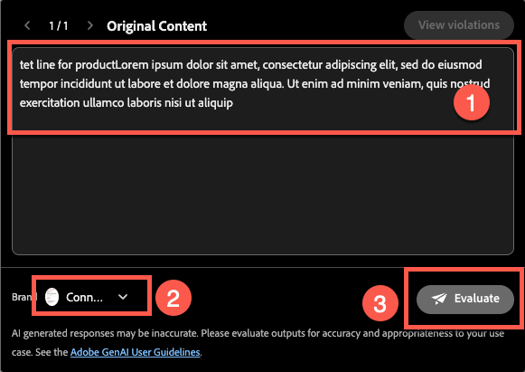

4. 予想どおり、ブランドガイドラインに違反するエラーが多数発生しています。 これらはAIを使用して修正できますが、この場合、このプレースホルダーテキストを修正する必要はありません。 代わりに、すべての新しいコンテンツを入力して説明を表示できます。

   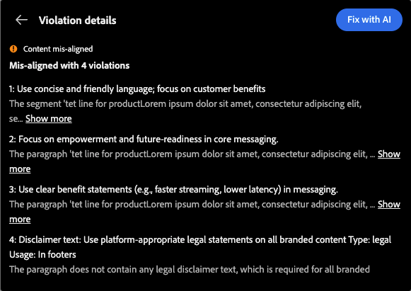

5. 以下のプロンプトを使用して、以前のヒーロータイトルと同じ手順を実行するか、時間を節約するために、プレースホルダーテキストを以下に提供される既製の段落に置き換えることもできます。

プロンプト：

>*新しいiPhone 17の魅力的な商品説明を作成します。 高度なカメラ、バッテリー寿命、パフォーマンスなど、最も印象的な機能を強調します。 トーンは、幅広いオーディエンスに対して、プレミアムで刺激的、かつ理解しやすいものである必要があります。 3文以内にしてください。*

準備完了の段落：

>IPhone 17™は、美しい写真を撮影するための高度なカメラを搭載し、一日中使い続けることができるバッテリー寿命、そして先を行く超高速のパフォーマンスを備えています。 この革新的な体験をお見逃しなく。

メールは次の例のようになります。

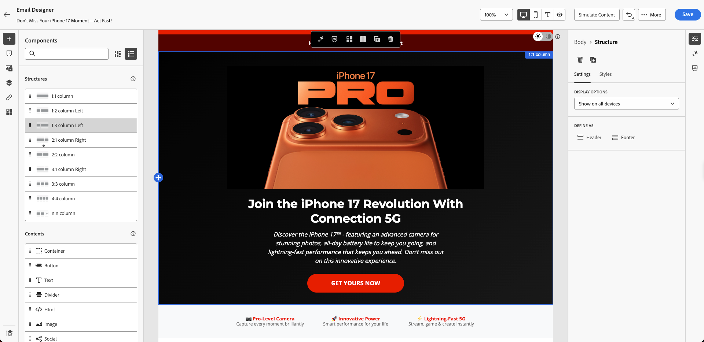

## Fireflyで生成された画像を追加

これまで、件名とテキストに関するAIのテストを行ってきました。 画像について？

AIによる画像生成に取り組む前に、どのような体験を構築できるかを確認しましょう。

私たちはプロファイルの誕生年があることを理解しています。 異なるバリエーションのブロックを作成することもできます。 Adobe Journey Optimizerなら、それが可能で、Adobe Experience Platformをベースとする最大のメリットのひとつです。 次のモジュールでは実験について説明しますが、まず以下のブロックを準備します。

1. **画像** コンポーネントをiphone 17 ファミリーブロックの下の左側の列にドラッグします。

   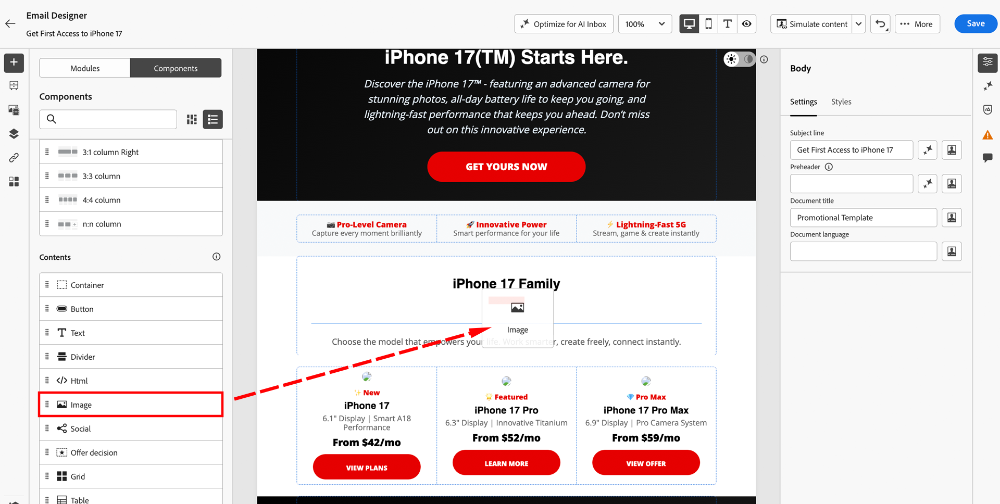

2. 外側をクリックして、画像プレースホルダーを選択します。 （必ず画像をクリックしてください。そうしないと、「Firefly」オプションが表示されません）。

   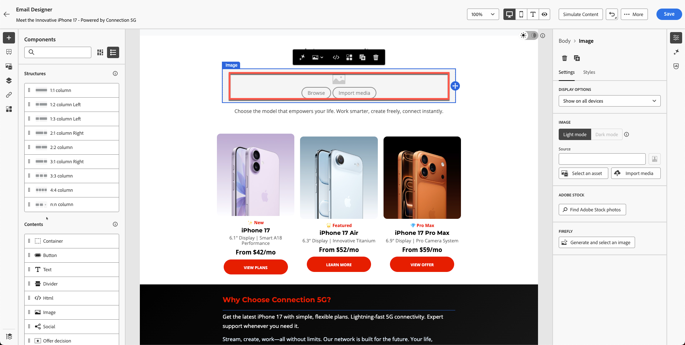

3. **Firefly**&#x200B;で、**生成をクリックして画像**&#x200B;を選択します。

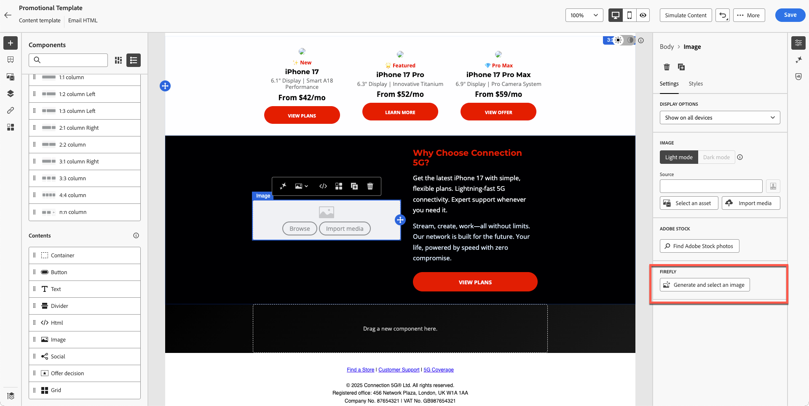

## 参照画像をアップロード

1. **参照スタイル**&#x200B;をオンにします。
2. ブランド選択時に&#x200B;**接続5G ブランドガイドライン**&#x200B;を選択

   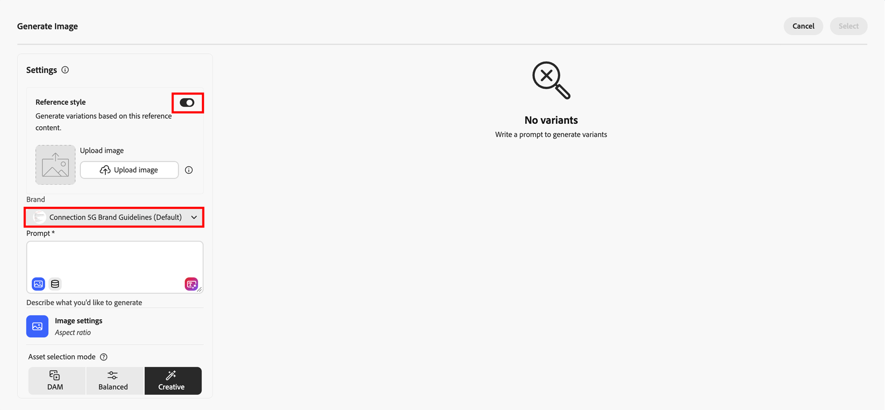

3. **画像をアップロード**&#x200B;をクリックします

   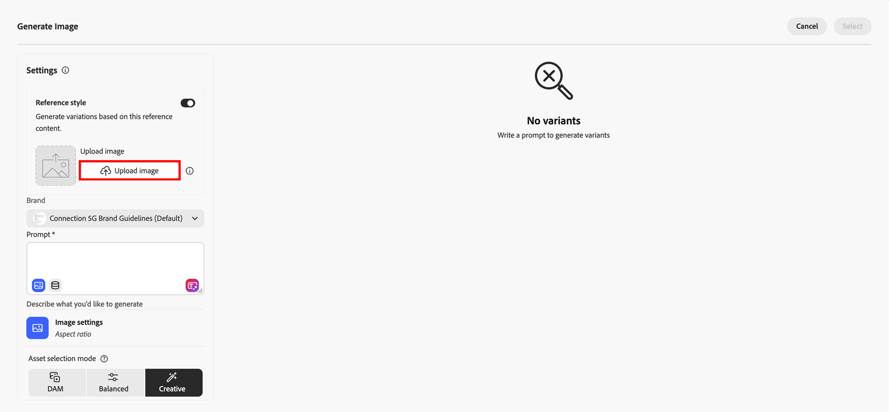

4. ツールキットフォルダーからreference.jpgを選択します

   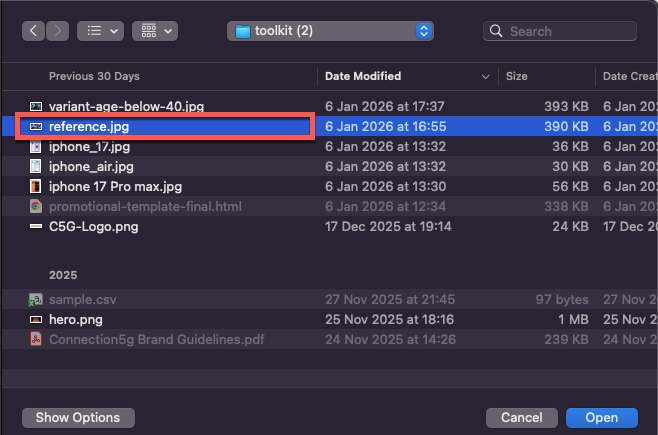

5. 画像プロンプトを追加
   `Portrait-oriented image of a confident man in his early to mid-40s, standing alone at night in a neon-lit urban street, focused on his smartphone. Cinematic cyberpunk-inspired city atmosphere with colorful LED signs, cool blue and warm orange lighting, shallow depth of field, soft bokeh lights in the background. Modern lifestyle, tech-savvy mood, realistic skin tones, high contrast, photorealistic, professional lighting, ultra-detailed`.

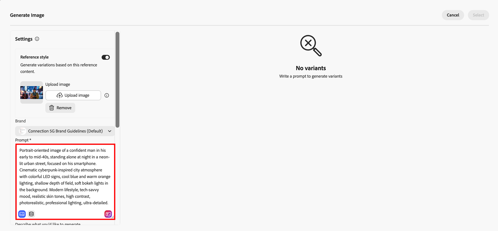

## 画像設定の選択

左列を下にスクロールして、**詳細設定**&#x200B;をクリックします

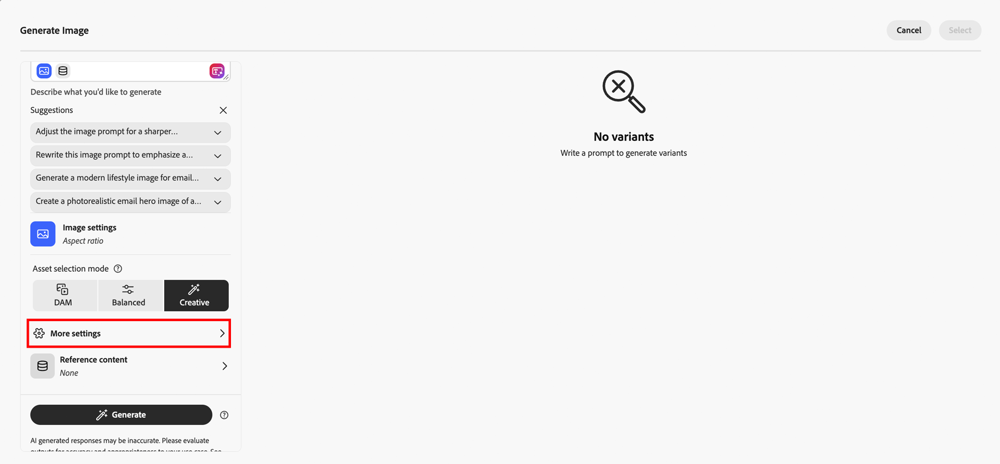

1. 次の設定を選択します。
   - **比率：**&#x200B;横（4:3）
   - **コンテンツの種類：**&#x200B;写真
   - **カラーとトーン：** クールなトーン
   - **照明：**&#x200B;劇的な照明

2. 「**生成**」ボタンを押します

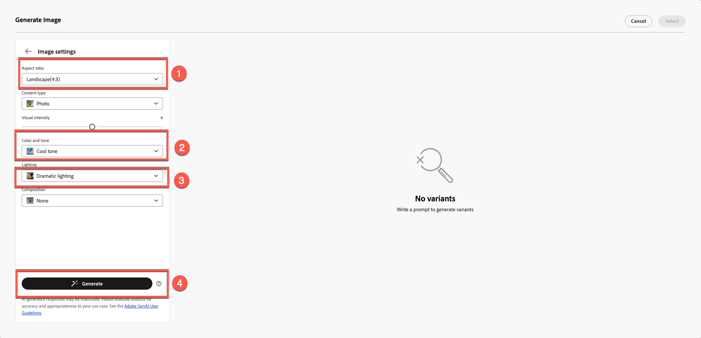

3. 右側のバリエーションを選択して表示し、後で使用するためにお気に入りの一部をお気に入りに&#x200B;**保存**&#x200B;します。 また、「複数回生成」をクリックすると、より多くのバリエーションを取得できます。

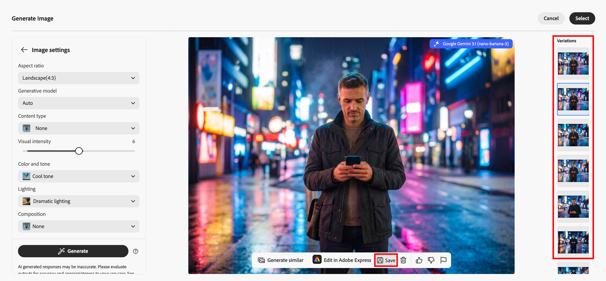

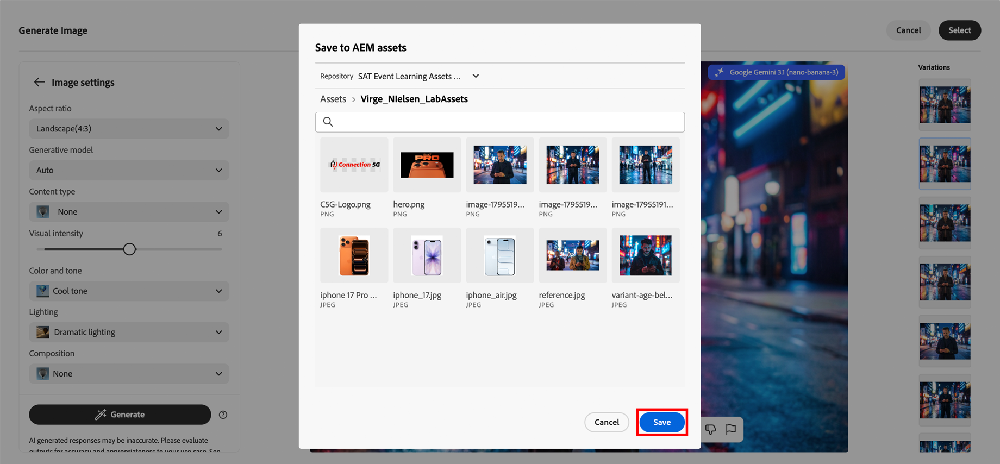

4. 次に、今のところ、画像生成インターフェイスから&#x200B;**キャンセル**&#x200B;します。

## ブロック設計を最終決定

1. 電子メールデザイナーインターフェイスに戻り、画像ブロックの「**参照**」をクリックします。

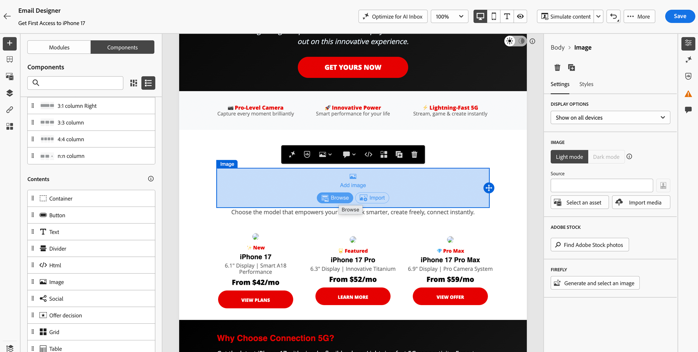

2. バリエーションのいずれかを選択し、**選択**&#x200B;をクリックします

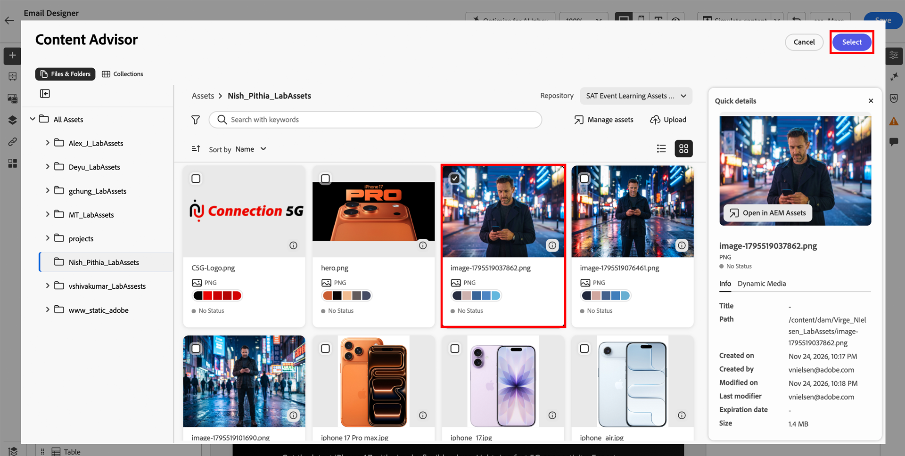

3. 右側の列の「**スタイル**」タブを選択し、丸みを帯びた境界線の半径を10に適用します

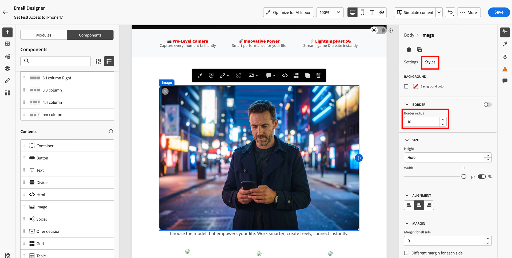

いくつかのイテレーションとバリエーションを経て、最終版のデザインが完成します。 最終的なレイアウトは、上記の例のようになります。

この時点で、AIを活用してコンテンツ制作を加速し、向上させることに自信を持つはずです。

## まとめ

AIを使用して、以下を行うことができました。

- 件名を生成
- ヒーローテキストを調整
- 段落を言い換える
- メッセージのトーンを変える
- 参照スタイルを使用したFireflyのブランドイメージの作成
- 生成された画像をメールに挿入する

これで、次のモジュールである&#x200B;**Personalizationとcontent experimentation**&#x200B;の準備が整いました。ここでは、プロファイル駆動型のバリエーションとテストを構築します。
