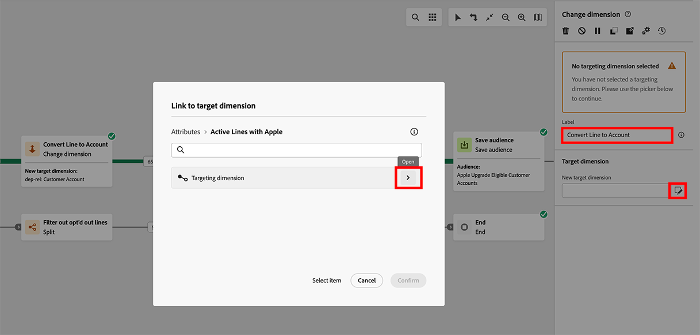
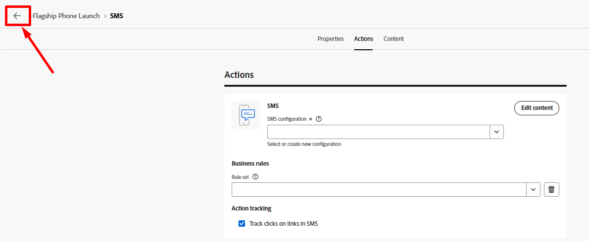

# 行をフィルタリング

## 目標

次の一連の手順では、行レベルでオプトアウトしているため、SMS メッセージで実際にターゲットにできない行をすべて除外します。  これが行レベルのターゲットであるため、プロファイルの同意に依存することはできません。

## 分割アクティビティの設定

1. フォークアクティビティの下部のトランジションにある&#x200B;**+** アイコンをクリックし、ポップアップで「**分割**」アクティビティを選択します。

   

2. 右側のパネルでラベルを更新し、次の内容を示します：`Filter out opt'd out lines`

   

3. 右側のパネルで、「**サブセット**」セクションを展開し、「**フィルターを作成**」ボタンをクリックします

   

4. SMS メッセージからオプトアウトされるすべての顧客行を削除する条件を追加し、**確認**&#x200B;をクリックします。

   

   >[!NOTE]
   >
   >条件の作成方法を理解する必要がありますが、最終的な結果は上記のスクリーンショットと一致します。  分かったぞ！

5. 右上の「保存」ボタンをクリックして、作品を保存します。  あなたのキャンバスは今このように見えます\...

## 変更ディメンションを追加

1. ワークフローキャンバスで、追加した分割条件の後にある&#x200B;**+** アイコンをクリックし、**ディメンションの変更** アクティビティを選択します

   

2. 次の概説に従って変更分析コードのプロパティを更新し、**確認**&#x200B;をクリックします。
ラベル： `Convert Line to Account`
新しいターゲットディメンション：`dep-rel: Customer Account`

   

   

## SMS アクティビティの追加

1. 追加したディメンションの変更の後にある&#x200B;**+** アイコンをクリックし、**モバイルメッセージ「Activity**」を選択します

   

   

2. 右側のパネルで「**モバイルメッセージを編集**」ボタンをクリックして、SMS メッセージの設定を開始します

   

3. 上部のナビゲーションで「アクション」メニュー項目をクリックし、「モバイルメッセージ設定」ドロップダウンから、以前に作成したチャネルを選択します。

>[!CAUTION]
>
>申し訳ありません🫨!  なぜ結果が出ないのか？  SMS チャネルを設定していませんか？  製品が壊れていますか？
>
>興奮して！!!!!!!!!

## フリークアウトモーメント

SMSのチャネル設定は既に設定されており、現在はこのように表示されています…

**この読み方は次のとおりです：**

- セカンダリディメンション（顧客明細）で見つかった関連レコードの数に関するメッセージを、ターゲットディメンション（顧客アカウント）ごとに1つ配信します
- セカンダリディメンション（顧客行）にある携帯電話番号を使用して、各SMS配信を実行します

複数のメッセージをひとつのプロファイルに送信できるこのユニークな機能は、ジャーニーとは一線を画すオーケストレーションキャンペーンの主な機能のひとつです。 ただし、モバイルメッセージアクティビティに移行する場合は、顧客アカウントに設定されます。 これにより、送信時にリアルタイム顧客プロファイルに結合して、メッセージの配信と追跡情報をプロファイルに関連付けることができます。

それをどのように機能させるかを考えます？ メッセージ実行のターゲットをチャネル設定😀と一致するように変更します

## ターゲットの変更とSMS メッセージ設定の完了

1. SMS編集画面の「戻る」ボタンをクリックします

   

2. モバイルメッセージアクティビティを選択した状態で、右側のパネルで、最初にTargetの選択肢をプロファイルごとに1つのメッセージから&#x200B;**セカンダリディメンションごとに1つのメッセージ** オプションに変更し、**モバイルメッセージを編集**&#x200B;に戻ります

   

3. 上部のナビゲーションで「**アクション**」メニュー項目をクリックし、「モバイルメッセージ設定」ドロップダウンから、以前に作成したチャネルを選択します。

   

## まとめ

オプトアウトのためにSMS メッセージでターゲットにすることが許可されていなかったすべての行をフィルタリングし、ディメンションを行からアカウントに変更し、最終的にターゲットにすることが許可されたユーザーのSMS アクティビティを正常に設定しました。
また、非常に重要なことを学んでいただけたと思います。**ターゲットは、使用するチャネル設定と一致している必要があります**
